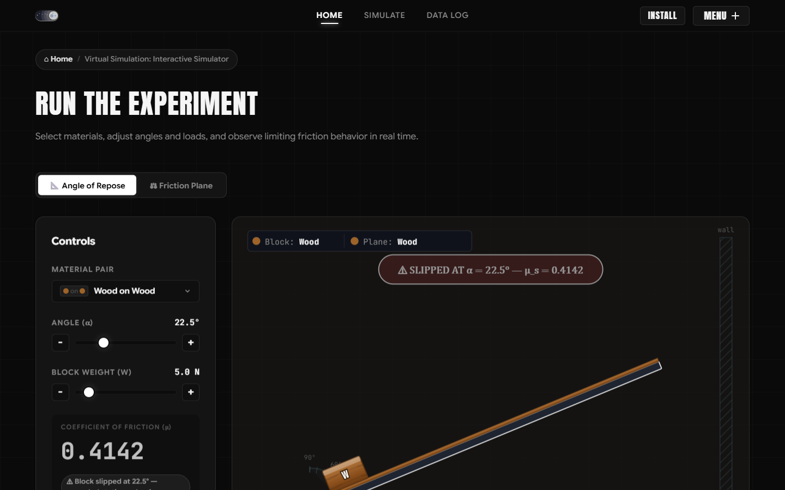
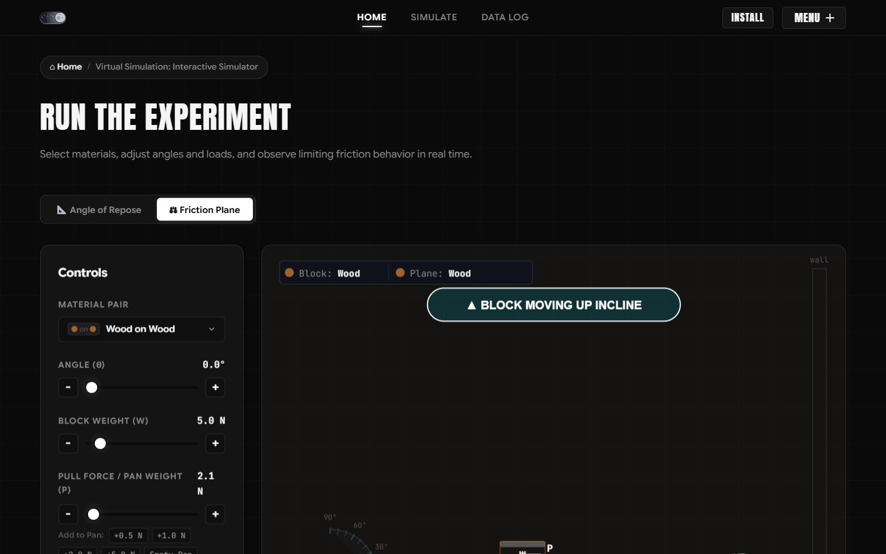
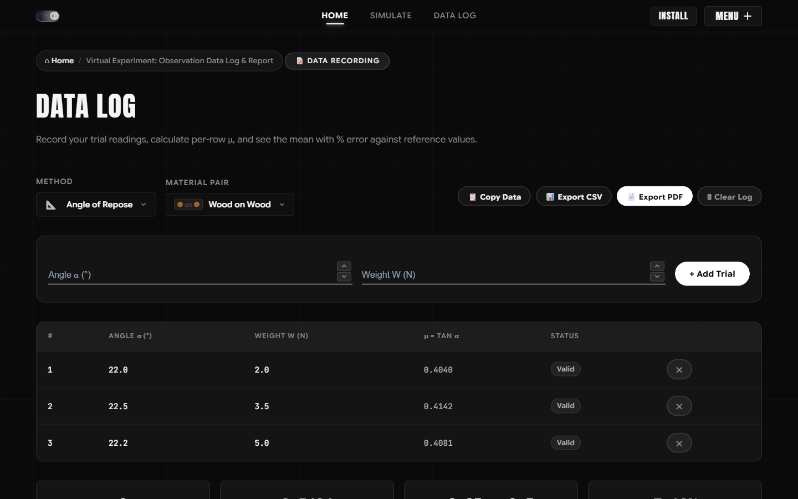
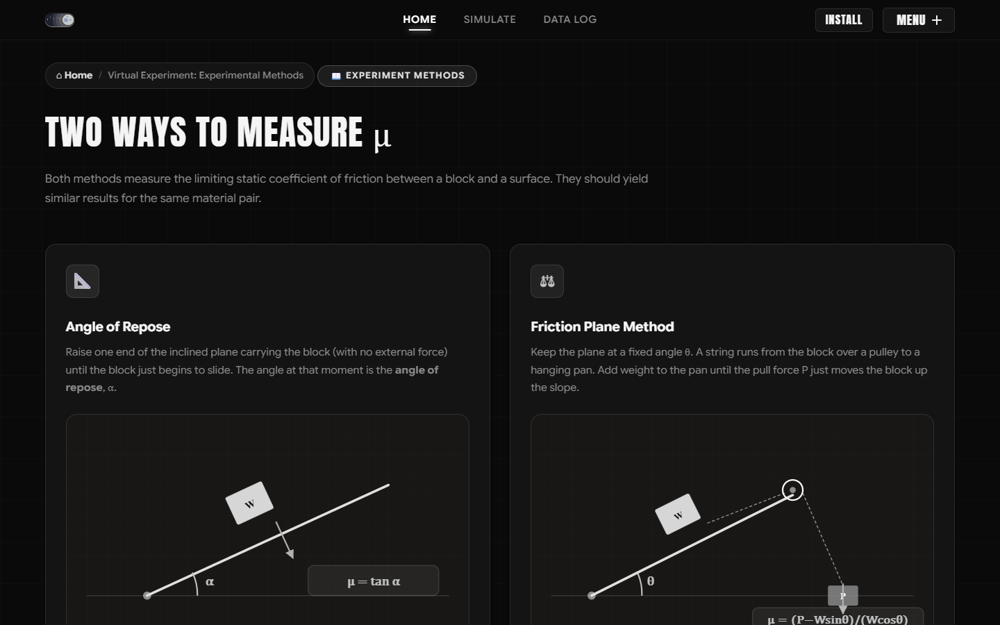

<div align="center">

# 📐 Coefficient of Friction ($\mu_s$) Virtual Simulation
### High-Precision Engineering Mechanics Laboratory & Interactive Simulator

[](https://github.com/omkarnub/friction)
[](https://github.com/omkarnub/friction)
[](https://github.com/omkarnub/friction)
[](https://github.com/omkarnub/friction)
[](https://github.com/omkarnub/friction)

<p align="center">
  An interactive, browser-based virtual mechanics laboratory designed for engineering undergraduates to determine the <b>static coefficient of friction ($\mu_s$)</b> between diverse engineering material pairs using two fundamental experimental techniques: the <b>Angle of Repose</b> and the <b>Friction Plane with Pulley &amp; Hanging Pan</b>.
</p>

[**Explore Simulator**](#-key-features) • [**Physics Theory**](#-first-principles-physics--mechanics) • [**Apparatus Manual**](#-experimental-methods) • [**Data Logging &amp; PDF Export**](#-data-logging--laboratory-reporting) • [**Project Team**](#-project-team--mentorship)

---

</div>

<br>

## 📸 Visual Showcase

<div align="center">

| Angle of Repose (Inclined Plane) | Friction Plane (Pulley Kinematics) |
| :---: | :---: |
|  |  |

| Live Data Logging &amp; Statistical Analysis | Comprehensive Cross-Method Comparison |
| :---: | :---: |
|  |  |

</div>

---

## ⚡ Key Features

- **🎯 Speed-Independent Deterministic Physics**  
  Every student at any interaction speed captures the exact theoretical limiting threshold ($\alpha_{\text{slip}}$ and $P_{\text{required}}$) across 0.1° fine steps, coarse drags, stepper clicks, or quick-add weight increments.
- **🖐️ Completely Fluid &amp; Unblocked Controls**  
  Sliders and input steppers are **never locked or disabled**. Students retain full physical agency to explore, tilt, load weights, test sensitivity, and re-test without frustrating control lockouts.
- **⚖️ 0.00% Cross-Method Experimental Agreement**  
  Both the Angle of Repose apparatus and the Friction Plane apparatus share a unified canonical thermodynamic dataset where $\mu_s = \tan(\alpha_{\text{slip}})$, producing exact $0.00\%$ cross-method deviation in side-by-side comparative analysis.
- **🔬 Live Free-Body Diagrams (FBD)**  
  Real-time SVG vector rendering for Normal Reaction ($\vec{N}$), Weight/Gravity ($\vec{W}$), Static Friction ($\vec{f}$), and Applied Pull Force ($\vec{P}$) with dynamically calculated lengths and angles.
- **⚙️ Realistic Mechanical Apparatus Animations**  
  - **Repose:** Accelerating slide-off physics down the incline with slip banner alerts and haptic feedback.
  - **Friction Plane:** Synchronized kinematics—slotted weights stack in a golden brass pan, the pulley rotates, cord tension wraps the axle, and the block climbs up the plane.
- **📊 Comprehensive Data Log &amp; Automated PDF Reporting**  
  Per-row $\mu$ calculation, automated validation checks, mean $\mu$, percent error calculation vs. handbook reference ranges, interactive SVG scatter chart, CSV export, clipboard sync, and one-click **publication-ready PDF lab report generation**.
- **📦 Single-File Standalone Distribution (`friction_standalone.html`)**  
  Completely bundled self-contained offline HTML distribution for classroom projection, laboratory computers, and air-gapped workstations without external network dependencies.

---

## 📚 First-Principles Physics & Mechanics

### Method 1: Angle of Repose (Inclined Plane)

When a body of weight $W$ rests on an inclined plane tilted at angle $\alpha$, the forces acting in equilibrium are:

$$\sum F_\parallel = W \sin\alpha - f_s = 0 \implies f_s = W \sin\alpha$$

$$\sum F_\perp = N - W \cos\alpha = 0 \implies N = W \cos\alpha$$

At the critical angle of repose $\alpha = \alpha_{\text{slip}}$, static friction reaches its limiting value $f_{\text{max}} = \mu_s N$:

$$W \sin\alpha_{\text{slip}} = \mu_s (W \cos\alpha_{\text{slip}}) \implies \tan(\alpha_{\text{slip}}) = \mu_s$$

$$\mu_s = \tan(\alpha_{\text{slip}})$$

> [!NOTE]
> **Mass Invariance:** The weight $W$ cancels out from both sides of the equation. In this simulator, increasing block load from $0.5\text{ N}$ to $50.0\text{ N}$ dynamically enlarges the block and force vectors, but the critical slip angle remains invariant.

---

### Method 2: Friction Plane (Horizontal & Inclined with Pulley)

A block of weight $W$ is pulled by an applied tension force $P$ from a hanging weight pan via an inextensible cord wrapping a ball-bearing pulley:

$$\sum F_\perp = N - W \cos\theta = 0 \implies N = W \cos\theta$$

For impending motion **up the inclined plane**, friction acts down the slope:

$$\sum F_\parallel = P - W \sin\theta - f_s = 0$$

At the limiting condition $f_s = \mu_s N$:

$$P_{\text{required}} = \mu_s W \cos\theta + W \sin\theta$$

$$\mu_s = \frac{P_{\text{required}} - W \sin\theta}{W \cos\theta}$$

When horizontal ($\theta = 0^\circ$):
$$P_{\text{required}} = \mu_s W \iff \mu_s = \frac{P}{W}$$

---

## 🧪 Canonical Engineering Materials Reference

All 9 material pairs are calibrated within standard engineering handbook intervals with small, non-zero errors (2.3%–5.5% vs. midpoint) to reflect authentic experimental behavior:

| Material Pair | Incline Board Material | Block Material | Canonical $\alpha_{\text{slip}}$ | Canonical $\mu_s$ | Handbook Reference Range | Midpoint | % Error |
| :--- | :--- | :--- | :---: | :---: | :---: | :---: | :---: |
| **Wood on Wood** | Hardwood Grain | Pine Block | **21.0°** | `0.3839` | 0.25 – 0.50 | 0.375 | **2.36%** |
| **Wood on Steel** | Polished Steel | Pine Block | **22.8°** | `0.4204` | 0.20 – 0.60 | 0.400 | **5.09%** |
| **Wood on Glass** | Smooth Plate Glass | Pine Block | **18.3°** | `0.3307` | 0.20 – 0.50 | 0.350 | **5.51%** |
| **Glass on Glass** | Smooth Plate Glass | Glass Slider | **42.6°** | `0.9195` | 0.90 – 1.00 | 0.950 | **3.21%** |
| **Steel on Steel (dry)** | Structural Steel | Steel Block | **31.8°** | `0.6200` | 0.50 – 0.80 | 0.650 | **4.61%** |
| **Steel on Steel (lubricated)**| Oiled Steel | Steel Block | **6.8°** | `0.1192` | 0.05 – 0.20 | 0.125 | **4.61%** |
| **Aluminum on Aluminum** | Satin Aluminum | Aluminum Block | **51.0°** | `1.2349` | 1.05 – 1.35 | 1.200 | **2.91%** |
| **Rubber on Concrete** | Textured Concrete | Vulcanized Rubber | **35.0°** | `0.7002` | 0.60 – 0.85 | 0.725 | **3.42%** |
| **Brass on Steel** | Polished Steel | Cast Brass | **22.3°** | `0.4101` | 0.35 – 0.50 | 0.425 | **3.50%** |

---

## 🛠️ Codebase Structure

```bash
mech/
├── index.html                   # Core application entrypoint & responsive UI layout
├── friction_standalone.html     # Single-file bundled standalone distribution
├── styles.css                   # Custom theme tokens, layout grid & animations
├── manifest.json                # Progressive Web App (PWA) manifest configuration
├── sw.js                        # Service worker for offline caching
│
├── js/
│   ├── simulate.js              # Pure physics evaluator, vector kinematics & SVG engines
│   ├── data-log.js              # Data table, statistical calculations, SVG chart & CSV export
│   ├── compare.js               # Cross-method statistical comparator (0.00% verification)
│   ├── pdf-export.js            # Vector PDF lab report generator (jsPDF)
│   ├── theory.js                # Interactive theoretical background & formula cards
│   ├── haptics.js               # Precision tactile feedback integration
│   ├── home-showcase.js         # Interactive landing showcase controllers
│   └── scroll-index.js          # Smooth section navigation & kinetic reveals
│
├── scripts/
│   ├── test-deterministic.js    # 19-assertion automated verification test suite
│   └── verify.js                # Build verification and linting checks
│
└── assets/
    └── manual/                  # Desktop & mobile documentation captures
```

---

## 🚀 Getting Started

### Local Browser Execution
Simply open `index.html` in any modern web browser (Google Chrome, Mozilla Firefox, Microsoft Edge, or Safari):
```bash
# Clone the repository
git clone https://github.com/omkarnub/friction.git

# Navigate to workspace
cd friction

# Open in browser (Windows PowerShell)
Start-Process index.html
```

### Running Automated Test Suite
To verify speed independence, canonical limiting values, and cross-method agreement:
```bash
node scripts/test-deterministic.js
```

---

## 👥 Project Team & Mentorship

<div align="center">

### Project Mentor & Guide
**Mr. Avinash Chavan**  
*Department of Engineering Mechanics • Academic Year 2026–27*

<br>

### Lead Developer
**Omkar Singh** ([@omkarnub](https://github.com/omkarnub))  
*Roll No: 31 • Department of Information Technology*

<br>

### Development & Research Contributors
| Contributor | Roll No | Department |
| :--- | :---: | :--- |
| **Mugdha Jagtap** | 09 | Information Technology |
| **Pranav Kotkar** | 11 | Mechanical Engineering |
| **Aayushi Mhaskar** | 15 | Electronics and Computer Science |
| **Piyush Gupta** | 07 | Electronics and Computer Science |
| **Harshit Sankhe** | 28 | Electronics &amp; Computer Science |

</div>

---

<div align="center">
  <sub>Developed for the Department of Engineering Mechanics • Academic Year 2026–27</sub>
</div>
